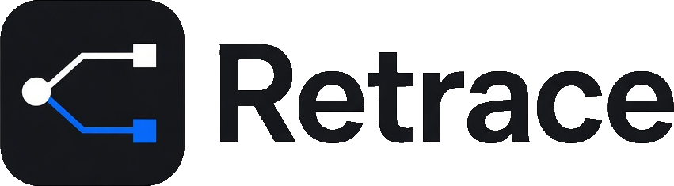
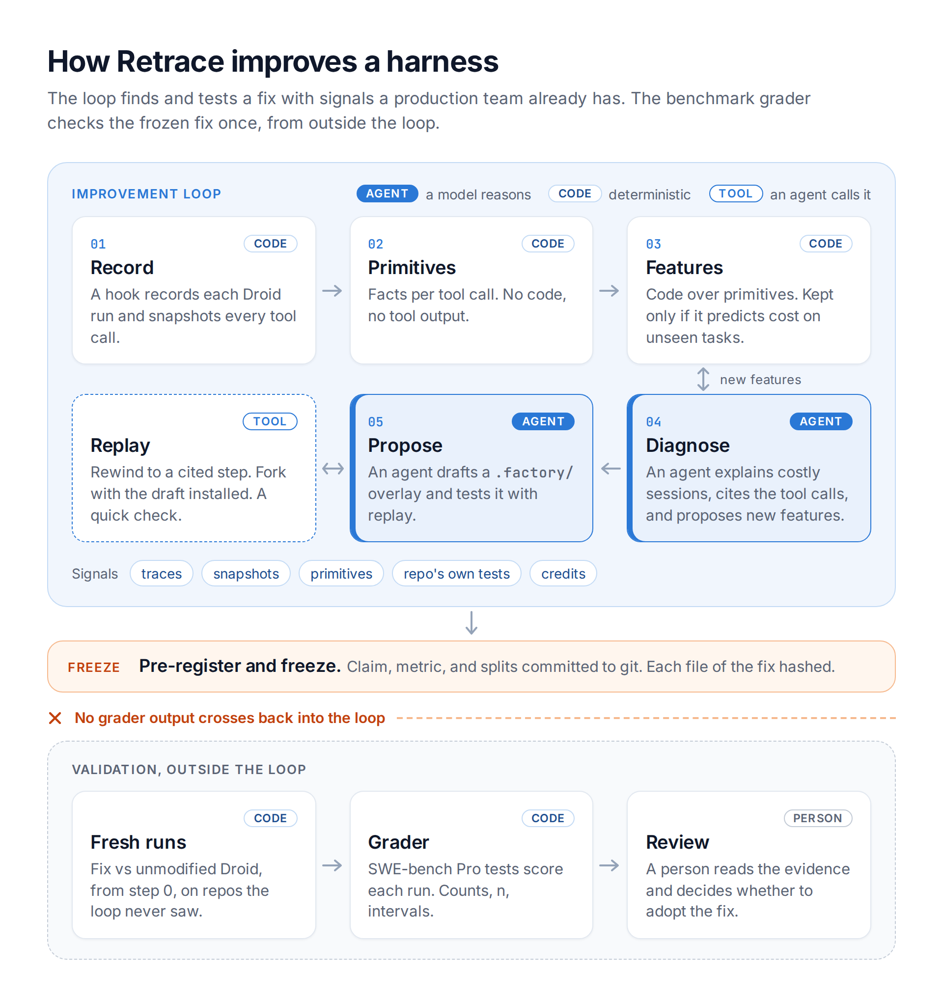
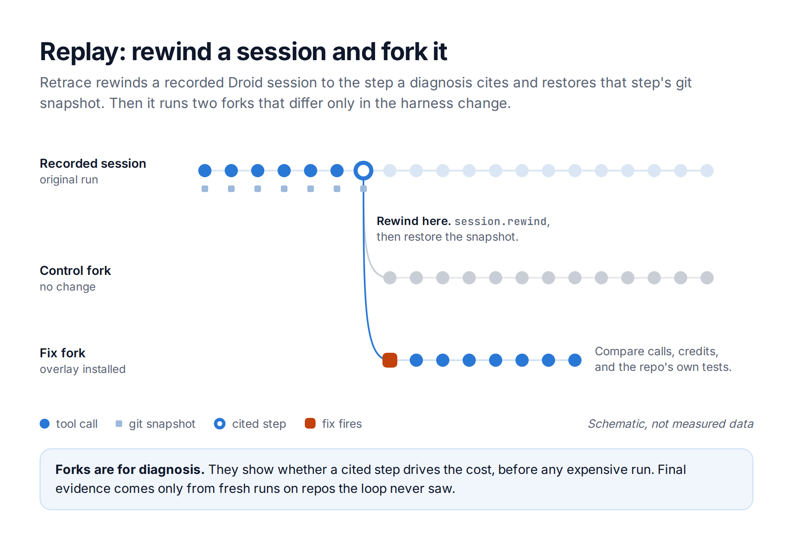
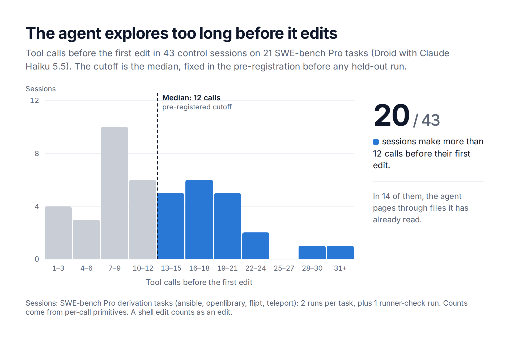
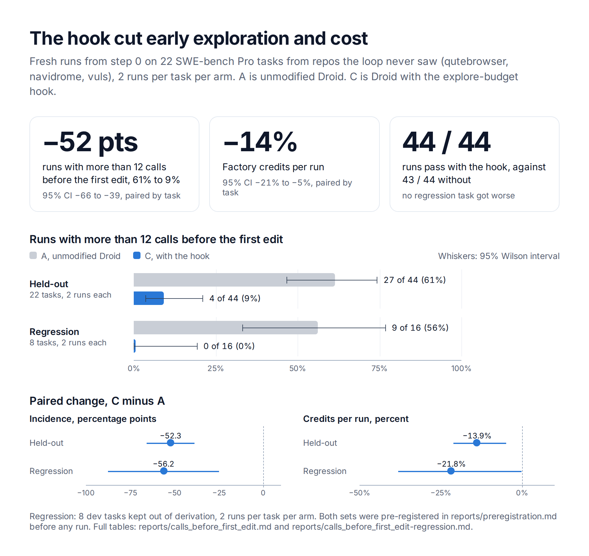
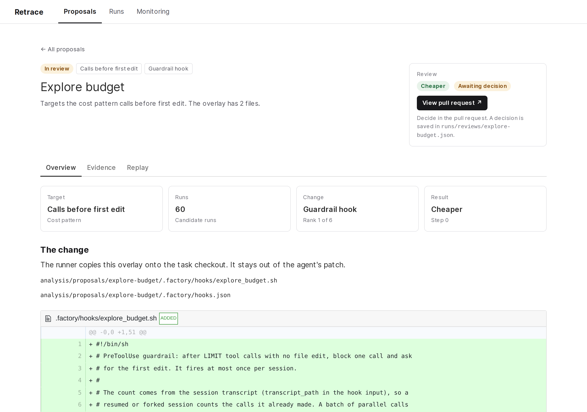

<p align="center">
  <picture>
    <source media="(prefers-color-scheme: dark)" srcset="docs/retrace-lockup-dark.png">
    
  </picture>
</p>

<p align="center">
  <b>Your coding agent keeps making the same mistakes.<br>Retrace finds them, replays them, and proposes a fix with proof it works.</b>
</p>

Retrace improves coding agent harnesses. It finds where an agent fails or wastes money, tests a fix by replaying recorded sessions, and validates the fix on repos the loop never saw. A person decides whether to adopt the fix. Built at Cal Hacks 13.0 on Factory Droid, with Tiger Data, Vultr, and Evidence.

**First result**, on SWE-bench Pro repos the loop never saw ([details](#result)):

- Runs that make more than 12 tool calls before the first edit fell from 61% to 9% (−52 points, 95% CI −66 to −39).
- Factory credits per run fell 14% (95% CI 5% to 21%).
- Pass rate did not drop: 44 of 44 runs pass with the fix, against 43 of 44 without.



## Why

The usual way to improve an agent from its traces is to ask an LLM what went wrong and what to change. That judgment is weak at both ends. On failure logs from LLM multi-agent systems, the best method found the decisive failing step only 14.2% of the time [1]. Repository context files such as `AGENTS.md` did not generally improve task success and raised inference cost by over 20% [2].

Systems that do evaluate their changes, such as DSPy [3], GEPA [4], the Darwin Gödel Machine [5], and Arize Prompt Learning [6], score each candidate inside the loop with a task metric or benchmark tests. A real team has no hidden test suite for its own sessions. Retrace runs its loop on signals a production system already has, and keeps the benchmark grader outside the loop.

## How it works

| Step | What it does | Code |
| --- | --- | --- |
| Record | Droid runs a task. A hook takes a git snapshot after every tool call. | `recorder/capture/` |
| Primitives | Each tool call becomes deterministic facts: class, duration, exit code, files, output size, position, repeats. No command text and no tool output. | `recorder/capture/primitives.py` |
| Features | Code over primitives and snapshots. A discovery step proposes new features, and a feature is kept only if it predicts credits on tasks it was not fit on. | `analysis/features/` |
| Diagnose | An agent explains the expensive sessions from the kept features and cites tool call ids. | `analysis/features/diagnose.py` |
| Replay | Rewind a recorded session to a cited step, restore its snapshot, and fork it with a fix installed. Forks are diagnosis only. | `recorder/replay/` |
| Propose | The fix is an overlay under `.factory/`: a hook, skill, custom droid, setting, or `AGENTS.md` rule. | `analysis/proposals/` |
| Validate | Freeze the fix, pre-register the claim, and run fix and control fresh from step 0 on held-out repos and a regression set. | `recorder/replay/run_final.sh`, `recorder/replay/report.py` |



### The grader stays out of the loop

Features, diagnoses, target choice, and proposal selection never read pass/fail, the gold patch, or the dataset's test lists. They use traces, primitives, snapshots, and the repo's own tests at the start commit. The grader scores only the frozen fix, and only people read that score, in `reports/`.

The code enforces this rule:

- `analysis/features/session.py` drops `passed` and `grader` from each result on load, and `analysis/features/test_mocks.py` fails if a feature module names them.
- The dashboard's database role reads the view `replay_runs`, which has no `passed` or `grader` column. It cannot read the results table.

## First case: calls before the first edit

Claude Haiku 5.5 in Droid passed 57 of 58 SWE-bench Pro dev trials, so cost was the target, not failure. An average Pro trial costs about 14,000 Factory credits. Discovery promoted one feature: calls before the first edit. It explains 16% of within-task credit variance on tasks it was not fit on.



The fix is `analysis/proposals/explore-budget`, a 51-line POSIX shell hook. After 10 tool calls with no edit, it blocks one call and asks the agent to make its first edit. It fires at most once per session. `FROZEN.md` in that directory lists the sha256 of each file at the freeze.

The test, pre-registered in `reports/preregistration.md`:

- Arms: unmodified Droid (A) against Droid with the hook (C), both fresh from step 0. Amendment 1 explains why the transcript-only arm (B) does not run.
- Held-out: 22 tasks from qutebrowser, navidrome, and vuls, repos the loop never saw.
- Regression: 8 dev tasks kept out of derivation.
- 2 runs per task per arm, `claude-haiku-5-5`, Droid 0.249.0.
- Primary outcome: the share of runs with more than 12 calls before the first edit. Secondary: paired Factory credits, pass rate, and test runs after the last edit.

### Result

On the held-out repos, the hook cut the targeted behaviour from 27 of 44 runs to 4 of 44. It cut credits by about 14%, with no drop in pass rate. Full tables are in `reports/calls_before_first_edit.md` and `reports/calls_before_first_edit-regression.md`.



The pre-registered claim holds: lower incidence on held-out tasks, and no regression task that A passes in every run and C fails in any run. The pass rates are near the ceiling, so this run cannot show a pass-rate gain. The regression set has 8 tasks, so its intervals are wide. The regression arm with the hook skipped verification more often (3 of 16 against 1 of 16). The held-out arm did not show this. The sample is too small to tell.

### Reproduce the result

The results, traces, and primitives of every run are committed under `runs/`. These commands rebuild both reports from them, byte for byte. They need Python 3 and nothing else: no worker, no API key, and no packages.

```bash
python3 recorder/replay/report.py --group calls_before_first_edit \
  --arm A=final1-heldout-a --arm C=final1-heldout-c --control A \
  --signal calls_before_first_edit --out /tmp/heldout.md
python3 recorder/replay/report.py --group calls_before_first_edit-regression \
  --arm A=final1-regression-a --arm C=final1-regression-c --control A \
  --signal calls_before_first_edit --out /tmp/regression.md
diff /tmp/heldout.md reports/calls_before_first_edit.md
diff /tmp/regression.md reports/calls_before_first_edit-regression.md
```

## Dashboard

The dashboard is the product view. It lists each proposal with its effect on the targeted behaviour, its credit change, and its proxy guard, and it shows no grader data. The fix above is open for review as [pull request #3](https://github.com/andrewy1n/retrace/pull/3).



## Layout

| Path | What it holds |
| --- | --- |
| `contracts/` | Schemas for traces, primitives, friction tickets, replay jobs, replay results, acceptance checks, and proposals, with fixtures, plus the Tiger SQL |
| `recorder/capture/` | Snapshot hook, trace writer, and primitives extractor |
| `recorder/replay/` | Checkpoint forks, final-run driver, and report writer |
| `recorder/worker/` | x86 worker setup, job runner, and SWE-bench Pro grading |
| `analysis/features/` | Features, discovery scoring, and diagnosis |
| `analysis/proposals/` | Proposed `.factory/` overlays |
| `runs/` | Traces, primitives, features, diagnoses, jobs, and results |
| `splits/` | Task pool and derivation, held-out, and regression ids |
| `reports/` | Pre-registration and frozen comparisons |
| `dashboard/` | Evidence dashboard: Proposals, Runs, and Monitoring. It shows no grader data. |
| `docs/devpost/` | Devpost description, figures, and their HTML sources |

## Run it

The SWE-bench images are amd64 only, so trials and grading run on an x86 worker. `recorder/worker/README.md` describes the worker setup. The repo root needs a gitignored `.env` with `FACTORY_API_KEY`, `VULTR_API_KEY`, and the Tiger URLs.

```bash
recorder/worker/remote.sh submit runs/jobs/<job-id>.json   # run and grade a job on the worker
recorder/worker/remote.sh fetch <job-id>                   # copy its results, traces, and primitives back
recorder/replay/run_final.sh final1                        # held-out and regression runs
recorder/replay/report.py --group calls_before_first_edit \
  --arm A=final1-heldout-a --arm C=final1-heldout-c --control A \
  --signal calls_before_first_edit                          # write the comparison
```

The dashboard steps are in `dashboard/README.md`:

```bash
cd dashboard && npm install && ./run.sh sources && ./run.sh dev   # http://localhost:3100
```

## Limits

- The agent needs the Factory API, so it has network access during a run. Results do not compare with the SWE-bench Pro leaderboard.
- One model, one Droid version, and one target so far.
- The samples are small: 22 held-out tasks with 2 runs each.
- The held-out and regression tasks have no acceptance checks. Of the two proxies left, `last_test_exit` agrees with the grader on 98.5% of held-out runs. `repo_tests` agrees on only 39%: it reports the same regressions in both arms on tasks the grader passes, and the cause is not found yet.
- Three teleport tasks run in Alpine images where Droid does not start. They are dropped from the pool.

## Team

- Andrew Yin: recording, replay, the worker, and the dashboard.
- Kate Fernandez: features, diagnosis, proposals, and the Tiger schema.

The friction ticket format and the detector ideas borrow from Factory Signals. Agent instructions are in `AGENTS.md`. The team plan is in the [project doc](https://docs.google.com/document/d/1sAXpAyjByro-vfbUc1EXLp-weLUiXahmg3GEDRCgrrw/edit).

## License

MIT. See `LICENSE`.

## References

1. S. Zhang et al. [Which Agent Causes Task Failures and When? On Automated Failure Attribution of LLM Multi-Agent Systems](https://arxiv.org/abs/2505.00212). ICML 2025.
2. T. Gloaguen et al. [Evaluating AGENTS.md: Are Repository-Level Context Files Helpful for Coding Agents?](https://arxiv.org/abs/2602.11988) ICLR 2026.
3. DSPy. [Optimizers](https://dspy.ai/learn/optimization/optimizers).
4. L. A. Agrawal et al. [GEPA: Reflective Prompt Evolution Can Outperform Reinforcement Learning](https://arxiv.org/abs/2507.19457). ICLR 2026.
5. J. Zhang et al. [Darwin Gödel Machine: Open-Ended Evolution of Self-Improving Agents](https://arxiv.org/abs/2505.22954). ICLR 2026.
6. Arize. [Optimizing Coding Agent Prompts for Execution](https://arize.com/docs/ax/cookbooks/prompt-learning/optimizing-coding-agent-prompts-for-execution).
